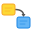

<p align="center">
  
</p>

# wema

[](https://github.com/kan/wema/actions/workflows/ci.yml)
[](https://www.npmjs.com/package/@kanf/wema)
[](./LICENSE)

Web上に付箋を絵馬のように貼って並べる、フレームワーク非依存のTypeScriptライブラリ。

付箋の作成・編集・自由配置・接続線描画を提供する。1ファイルで完結するスタンドアロンHTML版もあり、ブラウザで開くだけで使える。

**[デモを試す](https://kan.github.io/wema/)**

wema を使った Wiki に [wema-kake](https://github.com/kan/wema-kake)（npm: [`@kanf/wema-kake`](https://www.npmjs.com/package/@kanf/wema-kake)）がある。保存と同期まで含めて付箋のボードを使いたいなら、[wema-kake で Wiki として使う](#wema-kake-で-wiki-として使う)を参照。

## 使い方

### スタンドアロン版（最も簡単）

[デモページ](https://kan.github.io/wema/)でそのまま使うか、[Releases](https://github.com/kan/wema/releases) から `wema.html` をダウンロードしてブラウザで開く。

- 付箋の追加・編集・ドラッグ移動・リサイズ・削除
- 接続線（Edge）の作成・スタイル編集
- **接続線を空白にドロップ** → そこに新しい付箋を自動作成して接続
- **部分木の折り畳み** → 付箋にカーソルを乗せると折り畳みボタン（−）が出現。クリックで全ての接続先とその子孫を一括非表示。数字バッジをクリックで再展開
- リッチテキスト（太字、取り消し線、テキスト色、箇条書き、チェックボックス、リンク、画像、Embed）
- リストの段下げと段上げ（Tab / Shift+Tab）
- **引用** → 付箋の文字を選ぶと出るツールバーの引用ボタン（❞）で、選んだ文字を引用した付箋を隣に作り、元の付箋から矢印でつなぐ
- 複数選択・整列・均等配置・自動レイアウト
- Undo/Redo（Ctrl+Z / Ctrl+Y）
- autoSize モード（コンテンツに合わせて付箋サイズを自動調整）
- 長い付箋を畳んで表示（3 行以上の付箋は冒頭だけを見せ、「続きを読む」で開く）
- リサイズハンドルのダブルクリックで、付箋をコンテンツに合うサイズへ 1 回だけ変更
- 5色のカラーパレット
- IndexedDB による自動保存
- JSON エクスポート/インポート

### wema-kake で Wiki として使う

[wema-kake](https://github.com/kan/wema-kake) は、wema を使った Wiki。1 ページが 1 枚のボードで、付箋を置き、線でつなぎ、ページの中に子ページを置いて整理する。Cloudflare Workers の上で動き、複数のブラウザの間で同期し、Claude などの LLM からも MCP で読み書きできる。


wema-kake も npm パッケージ（[`@kanf/wema-kake`](https://www.npmjs.com/package/@kanf/wema-kake)）として配っている。雛形から自分のリポジトリを作り、自分の Worker としてデプロイする。

```sh
npx @kanf/wema-kake init my-wiki
cd my-wiki
npm run dev
```

デプロイと Cloudflare Access の設定の手順は、wema-kake の [README](https://github.com/kan/wema-kake#readme) にある。

wema はブラウザの中だけで動き、保存先や同期の仕組みを持たない。wema-kake は、そこに次のものを足している。

| wema が受け持つ | wema-kake が足す |
| --- | --- |
| 付箋と接続線の表示と編集 | ページという単位と、ページ間のリンク、ページの階層 |
| Undo / Redo、パンとズーム | サーバーへの保存と、複数のブラウザの間の同期（[リアルタイム同期](#リアルタイム同期)の API を使う） |
| 変更の内容を表すデータ（デルタ） | 全文検索、画像の保存、認証 |
| | LLM 向けの MCP サーバーと、その操作の取り消し |

wema を自分のアプリに組み込むときの実例としても読める。

### npm パッケージ

```bash
npm install @kanf/wema
```

```typescript
import { WemaBoard } from '@kanf/wema';
import '@kanf/wema/style.css';

const board = new WemaBoard({
  container: document.getElementById('board'),
});

// 付箋を追加
const note = board.addNote({ x: 100, y: 80, text: 'Hello!' });

// 接続線を追加
const note2 = board.addNote({ x: 400, y: 80, text: 'World!' });
board.addEdge(note.id, note2.id);

// データをエクスポート
const data = board.exportData();

// イベントを購読
board.on('change', ({ data }) => {
  console.log('Board changed:', data);
});
```

## API

### `WemaBoard`

```typescript
const board = new WemaBoard({
  container: HTMLElement,       // マウント先
  data?: WemaBoardData,        // 初期データ
  defaultNoteWidth?: number,   // default: 200
  defaultNoteHeight?: number,  // default: 150
  defaultNoteColor?: string,   // default: '#FFF9C4'
  createOnDblClick?: boolean,  // default: true
  readOnly?: boolean,          // default: false
  viewOnly?: boolean,          // default: false
  theme?: NoteTheme,           // default: 'default' ('default' | 'card')
  onImageUpload?: (file: File) => Promise<string>,  // 画像のアップロード先 URL を返す
  onLinkClick?: (url: string, event: MouseEvent) => boolean | void,  // 付箋内のリンクのクリックを処理する
  renderNote?: (note: WemaNote, container: HTMLElement) => boolean | void,  // 付箋の中身を利用側が描く
  renderNoteAccessory?: (note: WemaNote, container: HTMLElement) => boolean | void,  // 付箋のすぐ下に、利用側の小さな要素（印やボタン）を並べる
  renderNoteFooter?: (note: WemaNote, container: HTMLElement) => boolean | void,  // 縦に積んでいる間、付箋の下に利用側の要素を描く
  noteLinks?: boolean | { text?: (peer: WemaNote, edge: WemaEdge) => string | undefined | void, padding?: number },  // default: false（縦に積んでいる間、つながっている付箋を付箋の下に出す）
  labels?: Partial<WemaLabels>,  // 画面の文言（ボタンの説明、接続線のポップアップの見出しなど）。省略したキーは英語
  foldLabels?: { more?: string, less?: string },  // 畳んだ付箋を開閉するリンクの文言。labels の readMore / showLess と同じもの
  wheelPan?: boolean,          // default: true（ホイールで表示位置を動かす）
  wheelZoom?: boolean,         // default: true（Ctrl / Cmd + ホイールで拡大・縮小する）
  emptyDrag?: 'select' | 'pan',  // default: 'select'（空いている場所の左ドラッグ。'pan' でパン、選択は Shift か Ctrl / Cmd + ドラッグ）
  panMargin?: number,          // default: 200（操作でパンできる範囲。付箋の外側に見せる余白のピクセル数）
  pageScroll?: boolean,        // default: false（ボードをページと一緒にスクロールさせる。狭い画面向け）
  stacked?: { x?, y?, width?, gap?, order? },  // 付箋を縦 1 列に積んで表示する（データは変えない）
  minZoom?: number,            // default: 0.25
  maxZoom?: number,            // default: 2
});
```

`onImageUpload` を指定すると、付箋に挿入する画像を data URL で埋め込まず、返された URL の `` として挿入する。アップロードが完了してから挿入し、失敗したときは挿入せずに `image:error` イベントを発火する。未指定のときは従来どおり data URL で埋め込む。

付箋内のリンクは、クリックすると新しいタブで開く。`onLinkClick` を指定すると、クリックのたびにリンク先の URL とクリックイベントを渡して呼び出す。`true` を返した場合は新しいタブを開かないので、同じタブでの遷移などを利用側で行える。それ以外を返した場合は、指定しないときと同じく新しいタブで開く。

```typescript
const board = new WemaBoard({
  container,
  onLinkClick: (url) => {
    const target = new URL(url);
    if (target.origin !== location.origin) return false;  // サイト外は新しいタブで開く
    router.push(target.pathname + target.search + target.hash);
    return true;
  },
});
```

- **渡される URL は、ブラウザが解決した絶対 URL**（`href` 属性の値そのままではない）。サイト内のリンクかどうかは、オリジンを比べて判定すること。`//other.example/x` のように `/` で始まっていても別サイトを指す書き方があるので、文字列の先頭では判定できない
- 呼び出されるのは、URL の安全性の検査（`http` / `https` / `mailto` / `tel`、および相対リンク）を通ったリンクだけ。検査を通らないリンクは、クリックしても何も開かない
- 新しいタブで開くときも、同じ解決済みの URL を使う
- ブラウザ既定の遷移は wema が止めている（`event.defaultPrevented` は `true`）
- readOnly / viewOnly でも呼び出される

#### 画面の文言（`labels`）

wema が描く UI の文言は、何も指定しなければ英語で出る。対象は、付箋のポップアップ、接続線のポップアップ、文字のツールバー、画像の上のボタン、畳んだ付箋の開閉のリンク。`labels` オプションで差し替えられる。日本語の文言は `jaLabels` として同梱している。

```typescript
import { WemaBoard, jaLabels } from '@kanf/wema';

const board = new WemaBoard({ container, labels: jaLabels });
```

一部だけを変えるときは、変えるキーだけを渡す。渡さなかったキーは英語のまま出る。

```typescript
const board = new WemaBoard({
  container,
  labels: {
    ...jaLabels,
    duplicate: 'コピーを作る',
    deleteNotes: (count) => `選んだ ${count} 枚を削除`,  // 数の入る文言は関数で渡す
  },
});
```

- キーの一覧は、型 `WemaLabels` にある。英語の文言は `enLabels` として取り出せる。自分で訳を持つときは、`const labels: WemaLabels = { ... }` と型を付けておくと、wema が文言を足したときに、訳していないキーが型エラーになる
- アイコンだけのボタンには、同じ文言を `title`（ポインタを乗せたときの説明）と `aria-label`（読み上げ）の両方に入れる
- 文言は HTML として解釈しない
- 読むのは、ボードを作るときの 1 回だけ。作ったあとで言語を切り替えるには、ボードを作り直す
- どの言語にするかは、利用側が決めて渡す。wema は、ブラウザの言語設定を見ない
- 畳んだ付箋のリンクの文言（`readMore` / `showLess`）は、`foldLabels` オプションでも指定できる。両方を渡したときは `foldLabels` が使われる
- UMD 版では `Wema.jaLabels` / `Wema.enLabels`

#### 付箋

| メソッド | 説明 |
|---------|------|
| `addNote(params?)` | 付箋を追加 |
| `updateNote(id, params)` | 付箋を更新 |
| `deleteNote(id)` | 付箋を削除 |
| `getNote(id)` | IDで取得 |
| `getNotes()` | 全付箋を取得 |
| `refreshNote(id)` | `renderNote` オプションで描いた付箋と、`renderNoteAccessory` / `renderNoteFooter` オプションで付箋の下に描いた要素を描き直す。`noteLinks` オプションでは、その付箋と、つながっている付箋のボタンを描き直す |
| `resizeNotesToContent(noteIds)` | 付箋をコンテンツに合うサイズへ 1 回だけ変更する（`autoSize` は変えない） |

#### 長い本文を畳む（`foldable`）

付箋の `foldable` を `true` にすると、本文が 3 行以上のときに冒頭だけを表示する。1 行目と 2 行目をそのまま見せ、3 行目は薄くして、その上に続きを開くリンクを重ねる。開くと、リンクは本文の下へ移り、畳み直すリンクに変わる。2 行以下の付箋は、ふつうの付箋と同じ表示になる。

```typescript
const board = new WemaBoard({
  container,
  labels: { readMore: '続きを読む', showLess: '折り畳む' },  // リンクの文言（jaLabels にも入っている）
});

board.addNote({ text: '長い本文…', foldable: true });
board.updateNote(noteId, { foldable: true });   // あとから切り替える
```

付箋のポップアップにも、切り替えのボタンがある。

- 行数は、表示上の行で数える。改行がなくても、付箋の幅で折り返して 3 行以上になれば畳む
- `foldable` の付箋の高さは、表示している内容から決まる（閉じているときは約 3 行分、開いているときは本文の全体）。`height` は wema が計測して書き込む値になり、`updateNote()` やリサイズハンドルで指定できるのは幅だけになる。接続線、整列、自動レイアウトは、その時点の表示の大きさに従う
- **開いているかどうかは、表示だけの状態。** データには入らない。`note:update` と `history:commit` を出さず、Undo の対象外。ボードを読み込んだ直後は、すべて閉じている。ロックモードと参照モードでも開閉できる
- 開閉で高さが変わると `note:measure` と `change` が発火する。`change` の `data` の `height` は、その時点の表示の高さになる
- 本文を編集しているあいだは、閉じている付箋も一時的に開く。フォーカスが外れると元の状態へ戻る
- `foldable` を `false` に戻すと、高さは本文の全体が収まる値になる（非表示の付箋は計測できないので、そのときの高さのまま残る）
- `renderNote` で利用側が描いた付箋は畳まない
- 「部分木の折り畳み」（接続線の `collapsed`。接続先の付箋を隠す）とは別の機能

#### 付箋に利用側のデータを持たせる（`meta`）

付箋の `meta` は、利用側が自由に使える項目。wema は中身を読まず、保存してそのまま返す。本文（`text`）とは別なので、本文を編集しても変わらない。

```typescript
const note = board.addNote({ text: '子ページ', meta: { page: 'child-1' } });
board.getNote(note.id)?.meta;                        // { page: 'child-1' }
board.updateNote(note.id, { meta: { page: 'child-2' } });  // 全体を置き換える
board.updateNote(note.id, { meta: undefined });      // 取り除く
```

- 値は文字列だけ（`Record<string, string>`）。文字列以外の値は保存時に落とす。入れ子のデータを持たせたいときは、利用側で JSON の文字列にする
- 返される `meta` は凍結されている（書き換えると例外になる）。変えるときは、新しいオブジェクトを `updateNote()` に渡す。`updateNote()` は `meta` の全体を置き換える（キーごとのマージはしない）
- `getNote()` / `getNotes()` / `exportData()` / `importData()`、付箋のイベント、`history:commit` のデルタ、`applyRemote()`、Undo / Redo を通して値が保たれる
- 中身が同じ `meta` を渡した更新は、変更として扱わない（履歴にも `history:commit` にも載らない）
- **付箋を複製しても `meta` は引き継がない。** 複製した付箋は、本文、色、大きさだけを引き継ぐ
- 大きさと形の上限は設けていない。同期する場合は、受け取る側（サーバー）で検証すること

#### 付箋の中身を利用側が描く（`renderNote`）

`renderNote` を指定すると、付箋ごとに呼び出す。`container` に DOM を作って `true` を返すと、その付箋は本文の代わりに `container` の中身を表示する。それ以外を返した付箋は、ふつうの付箋のまま本文を表示する。

```typescript
const board = new WemaBoard({
  container,
  renderNote: (note, el) => {
    const slug = note.meta?.page;
    if (!slug) return false;              // ふつうの付箋
    const title = document.createElement('strong');
    title.textContent = pages.get(slug)?.title ?? slug;
    const open = document.createElement('button');
    open.textContent = '開く';
    open.addEventListener('click', () => router.push(`/p/${slug}`));
    el.append(title, open);
    return true;
  },
});

// 付箋のデータ以外（ページの表示名など）が変わったら、描き直しを頼む
board.refreshNote(noteId);
```

- 呼び出すのは、付箋を作ったとき（`importData()`、`applyRemote()`、Undo での復活を含む）、付箋の `text` または `meta` が変わったとき、`refreshNote(id)` を呼んだとき。移動、リサイズ、色の変更では呼ばない
- `container` は、呼び出しのたびに空にしてから渡す。前回付けたイベントリスナーは要素ごと消える
- 利用側が描いた付箋は、本文を編集できない。ポップアップにも、本文の書式（リスト、画像、埋め込み）のボタンを出さない。本文（`text`）はデータに残り、`exportData()` はそのまま返す
- それ以外はふつうの付箋と同じ。移動、リサイズ、選択、削除、接続線、整列、自動レイアウト、絞り込み、折り畳みの対象になる
- `container` の中をドラッグすると、付箋が動く。リンク、ボタン、入力欄（`a` / `button` / `input` / `select` / `textarea` / `label` / `summary`）と、`data-wema-no-drag` 属性を付けた要素の上では、ドラッグを始めない
- `container` の中のクリックは、付箋の選択にもなる（ポップアップが出る）。出したくないときは、利用側のハンドラで `event.stopPropagation()` を呼ぶ
- **`container` の中身は、wema のサニタイズを通さない。** 他人が書いた文字列（`meta` や本文を含む）を出すときは、`innerHTML` ではなく `textContent` を使うこと
- readOnly / viewOnly でも呼び出し、中のボタンやリンクは押せる
- `container` の中の入力欄（`input` / `textarea` / `select`、`contenteditable` の要素）にフォーカスがあるあいだ、ボードのキーボードショートカット（Delete、Undo / Redo、Space）は働かない
- `renderNote` が例外を投げたときは、コンソールにエラーを出し、その付箋をふつうの付箋として表示する。付箋の作成や `importData()` は止まらない
- `refreshNote()` はデータを変えない。イベントも履歴も出さない

#### 付箋に利用側の小さな要素を並べる（`renderNoteAccessory`）

付箋の本文はそのままにして、付箋のすぐ下に、印やボタンを置ける。作者の印、「いいね」のボタンと数のように、付箋のデータの外にあるものを付箋の近くで見せるために使う。`container` に DOM を入れて `true` を返すと表示する。それ以外を返した付箋には、何も置かない。

```typescript
const board = new WemaBoard({
  container,
  renderNoteAccessory: (note, el) => {
    const info = infoOf(note.id);          // 利用側が、付箋の id ごとに持っている値
    if (!info) return false;               // 何も置かない
    if (info.byAgent) {
      const badge = document.createElement('span');
      badge.className = 'badge';
      badge.textContent = 'AI';
      el.append(badge);
    }
    const like = document.createElement('button');
    like.dataset.wemaFocusKey = 'like';    // 描き直しても、フォーカスを残す
    like.textContent = `♥ ${info.likes}`;
    like.addEventListener('click', () => sendLike(note.id));
    el.append(like);
    return true;
  },
});

// 「いいね」の数が届いたら、この領域だけを描き直す
board.refreshNoteAccessory(noteId);
```

| メソッド | 説明 |
|---------|------|
| `refreshNoteAccessory(id)` | `renderNoteAccessory` で描いた要素だけを描き直す。`renderNote` と、付箋の下のボタン（`noteLinks` / `renderNoteFooter`）は描き直さない。無い付箋の ID を渡しても、何もしない |

- **置く場所は、付箋の枠のすぐ下（外側）。** 幅は付箋と同じ。付箋の箱の大きさは変わらない
- **付箋のデータは変わらない。** `width` / `height`、`getNote()`、`exportData()` は、この要素の有無で変わらない。`note:update` / `note:measure` / `history:commit` / `change` も発火しない
- **縦に積んでいても、いなくても表示する。** 積んでいないときは場所を取らないので、下の付箋に重なることがある。積んでいる間（`setStacked()`）は、列がこの要素の高さを空ける。`noteLinks` / `renderNoteFooter` の要素は、この要素の下に並ぶ
- `noteLinks`、`renderNoteFooter`、`renderNote` と一緒に使える。`renderNote` で利用側が描いた付箋にも置ける
- `container` は、要素を横に並べる入れ物（`display: flex`、折り返しあり、間隔 4px）。並べ方は、`.wema-note-accessory` に CSS を書いて変える。右に寄せるなら `justify-content: flex-end`
  - 付箋の下辺の中央には、折り畳みのボタンとアンカーが出る。要素は左右のどちらかに寄せるとよい
  - 付箋との間隔は、`.wema-note-accessory` の `padding-top` で空ける。負の `margin-top` で付箋の縁に重ねると、右下のリサイズハンドルや下辺のアンカーを要素が覆い、押せなくなる
- **ポインタを受けるのは、`container` に直接入れた要素だけ。** 要素の無い部分は、クリックを下の付箋やボードへ通す。要素を自前の行で包むと、その行が幅いっぱいにクリックを受けるので、包むなら行に `pointer-events: none`、中の要素に `pointer-events: auto` を指定する
- 中の要素のクリック、押下、キー入力は、付箋の選択、ドラッグ、編集、ボードのショートカットにならない
- **ホバー中と選択中は、CSS で見分けられる。** `container` は付箋の要素（`.wema-note`）の中にあり、選択中の付箋には `wema-note-selected` クラスが付く（このクラス名は変えない）

  ```css
  /* 作者の名前は、ホバーか選択のときだけ見せる */
  .wema-note-accessory .author { visibility: hidden; }
  .wema-note:hover .wema-note-accessory .author,
  .wema-note-selected .wema-note-accessory .author { visibility: visible; }
  ```

  - **積んでいる間は、ホバーで領域の高さを変えない。** 高さを変えると、wema が列を積み直すので、ポインタの下で付箋が動く。隠し方は 2 つあり、どちらにも向き不向きがある
    - `visibility: hidden`（上の例）: 隠していても高さを取る。ホバーで出しても列は動かない。そのかわり、積んでいる間は、何も見えていない付箋の下にも、その分の間隔が空く
    - `display: none`: 隠している間は高さを取らないので、間隔は空かない。出すと列が動くので、積んでいる間は、ホバーでは出さず、付箋を選んだときやボタンを押したときだけ出す
  - `opacity` で透明にした要素は、見えないままクリックを受けて、下の付箋の操作を止める。隠す目的には使わない

- 呼び出すのは、付箋を作ったとき（`importData()`、`applyRemote()`、Undo での復活を含む）、付箋の `text` または `meta` が変わったとき、`refreshNote(id)` か `refreshNoteAccessory(id)` を呼んだとき。readOnly / viewOnly でも呼ぶ
- **呼び出しは、きっかけになった処理が終わってから、まとめて行う**（ブラウザが描く前）。同じ付箋は、何度頼んでも 1 回だけ呼ぶ。関数の中で、`new WemaBoard()` の戻り値や、利用側が持つ値を読める。数が届くたびに `refreshNoteAccessory()` を呼んで構わない
  - 例外: 積んでいる間は、付箋の画面上の位置を読むメソッド（`revealNotes()` / `centerContent()` / `fitToContent()`）が、呼んだ時点で、頼まれている分を先に描く（列の位置が決まらないため）。積んでいないときは、この例外は無い
- `container` は、呼び出すたびに、空にしてから渡す。`data-wema-focus-key` 属性を付けたボタンは、描き直したあと、同じ値のボタンへフォーカスを戻す
- **`container` の中身は、wema のサニタイズを通さない。** 他人が書いた文字列（作者の名前など）を出すときは、`innerHTML` ではなく `textContent` を使うこと
- 付箋を選択したときのポップアップは、この要素の下に出る
- 重なり順は付箋に従う。手前にある別の付箋（後から触った付箋）の下に隠れることがある。ズームでは、付箋と一緒に拡大、縮小される
- `revealNotes()` / `centerContent()` / `fitToContent()` と、`pageScroll` のページの高さは、この要素を付箋の一部として扱う
- 描き直しても、要素の高さが変わらなければ、列の積み直しは起きない
- `renderNoteAccessory` の中から、描いている付箋に `refreshNoteAccessory()` / `refreshNote()` を呼んでも、何もしない（呼び出しが止まらなくなるのを防ぐため）
- `renderNoteAccessory` が例外を投げたときは、コンソールにエラーを出し、その付箋には何も置かない

#### 接続線（Edge）

| メソッド | 説明 |
|---------|------|
| `addEdge(from, to, params?)` | 接続線を追加 |
| `updateEdge(id, params)` | 接続線を更新（線種・矢印・太さ・折り畳み等） |
| `deleteEdge(id)` | 接続線を削除 |
| `getEdges()` | 全接続線を取得 |
| `getEdgesOf(noteId)` | 指定付箋に接続された線を取得 |
| `getSelectedEdge()` | 選択中の接続線IDを取得 |

#### 選択

| メソッド | 説明 |
|---------|------|
| `select(noteIds)` | 付箋を選択 |
| `selectAll()` | 全選択 |
| `getSelection()` | 選択中のIDを取得 |

非表示の付箋（折り畳みや絞り込みで隠れているもの）は選択できない。

選択中の付箋の要素（`.wema-note`）には、`wema-note-selected` クラスが付く。利用側の CSS で、選択中だけ見せるものを書ける（「付箋に利用側の小さな要素を並べる」の例）。

#### 絞り込み

| メソッド | 説明 |
|---------|------|
| `setNoteFilter(noteIds)` | 指定した付箋だけを表示する。`null` で解除 |
| `getNoteFilter()` | 表示対象の ID を取得。絞り込んでいなければ `null` |
| `isNoteHidden(id)` | 付箋が非表示か（絞り込みの対象外、または折り畳んだ接続線の先）。存在しない ID には `false` |

```typescript
board.setNoteFilter(matchedIds);  // 一致した付箋だけを残す
board.setNoteFilter(null);        // 全部表示に戻す
```

- 付箋の表示と非表示が変わると、`note:visibility` が発火する（「イベント」の節）。折り畳みのバッジを押して開いたときも発火する
- 表示対象でない付箋と、その付箋につながる接続線を非表示にする
- データは変えない。`note:*` / `edge:*` / `history:commit` / `change` は発火せず、Undo 履歴にも積まれない。`exportData()` は全部の付箋と接続線を返す
- 非表示になった付箋と接続線は選択から外れ、付箋は全選択やラバーバンド選択の対象にもならない
- ID を指定して呼ぶメソッド（`updateNote` / `deleteNote` / `alignNotes` / `autoLayout(noteIds)` など）は、非表示の付箋にも作用する
- `getNoteFilter()` が返すのは現在の表示対象で、`setNoteFilter()` に渡した配列そのものではない（絞り込み中に作成した付箋が加わり、削除した付箋の ID も残る）
- 折り畳み（`collapsed`）と両立する。表示対象の付箋どうしをつなぐ接続線が折り畳まれていれば、その先の付箋は表示対象でも隠れる。両端のどちらかが表示対象でない接続線の折り畳みは、絞り込みの間は無視する（展開するボタンを出せないため）
- readOnly / viewOnly でも使える
- 絞り込み中にユーザーが作成した付箋は、表示対象に加わる。`applyRemote()` で届いた付箋と、Undo / Redo で復活した付箋は加わらず、もう一度 `setNoteFilter()` を呼ぶまで非表示のまま
- 絞り込み中に引数なしで `autoLayout()` を呼ぶと、表示対象の付箋だけを配置する
- `importData()` を呼ぶと絞り込みは解除される

#### 表示位置（パンとズーム）

ボードはコンテナの大きさで表示し、はみ出した付箋へは表示位置を動かして届く。倍率を下げれば、広い範囲を一度に表示できる。

| メソッド | 説明 |
|---------|------|
| `getViewport()` | 表示位置と倍率 `{ x, y, zoom }` を取得 |
| `setViewport({ x?, y?, zoom? })` | 表示位置と倍率を設定 |
| `zoomTo(zoom, center?)` | 倍率を設定する。`center`（`{ clientX, clientY }`）の下にある点を画面上で動かさない。省略時はボードの中央 |
| `revealNotes(noteIds, options?)` | 指定した付箋が見えるよう、必要な分だけ表示位置を動かす。倍率は変えない |
| `centerContent(options?)` | 付箋全体（絞り込み中は表示対象）がボードの中央に来るよう動かす。倍率は変えない。`options.noteIds` で対象を絞れる |
| `fitToContent(options?)` | 付箋全体（絞り込み中は表示対象）がボードに収まる倍率と位置にする。`options.noteIds` で対象を絞れる |

```typescript
board.setNoteFilter(matchedIds);
board.fitToContent();          // 残った付箋が収まるように表示する
board.revealNotes([noteId]);   // この付箋が見える位置まで動かす
board.zoomTo(1);               // 等倍に戻す
```

- `x` / `y` は、ボードの内容を画面上でずらす量（ピクセル）。`zoom` は倍率（1 が等倍）。ボード座標 `(nx, ny)` の付箋は、ボード要素の中の `(nx * zoom + x, ny * zoom + y)` に描かれる
- 表示位置や倍率を変えても、付箋の座標と大きさ（`x` / `y` / `width` / `height`）は変わらない
- 倍率は `minZoom`〜`maxZoom`（既定値 0.25〜2）に収める。範囲外の値を渡すと、範囲の端の値になる
- `setViewport({ zoom })` のように `zoom` だけを渡すと、ボード座標の原点を中心に拡大・縮小する。画面上の点を中心にするには `zoomTo()` を使う
- `fitToContent` は、付箋が少ないときに等倍より大きくしない。大きくしてよい場合は `options.maxZoom` で上限を指定する（ボードの `maxZoom` を超えることはない）
- 表示位置は各クライアントの表示状態として扱う。`note:*` / `edge:*` / `history:commit` / `change` は発火せず、Undo 履歴にも積まれない。発火するのは `viewport:change` だけ
- `exportData()` は表示位置を含めず、`importData()` は表示位置を変えない。保存したい場合は `getViewport()` で取得し、`setViewport()` で戻す
- readOnly / viewOnly でも使える
- `revealNotes`、`centerContent`、`fitToContent` は、非表示の付箋（折り畳み、絞り込み）を対象から外す。対象がボードに収まらないとき（`fitToContent` では、最小の倍率でも収まらないとき）は、左上を表示する。`options.padding` で、ボードの端との間隔を画面のピクセルで指定できる（既定値 24）
- 座標を省略した `addNote()` は、表示中の領域の左上から (100, 100) の位置に付箋を作る
- 表示位置や倍率を変えると、付箋や接続線のポップアップなども一緒に動く。ポップアップ自体の大きさは変わらない

利用者の操作は次のとおり。

| 操作 | 通常 | ロック（readOnly） | 参照（viewOnly） |
|------|------|------|------|
| ホイール（Shift で横） | パン | パン | パン |
| Ctrl / Cmd + ホイール、トラックパッドのピンチ | ズーム | ズーム | ズーム |
| 中ボタンのドラッグ | パン | パン | パン |
| Space + 左ドラッグ | パン | パン | パン |
| 空いている場所の左ドラッグ | ラバーバンド選択（`emptyDrag: 'pan'` ではパン） | パン | パン |
| 空いている場所の Shift + 左ドラッグ | ラバーバンド選択 | パン | ラバーバンド選択 |
| 空いている場所の Ctrl / Cmd + 左ドラッグ | ラバーバンド選択 | パン | パン（`emptyDrag: 'pan'` ではラバーバンド選択） |
| 空いている場所のダブルクリック | 付箋を作成 | その位置を中央へ | その位置を中央へ |
| リサイズハンドルのダブルクリック | 付箋を内容に合うサイズへ変更 | （ハンドルなし） | （ハンドルなし） |

- 中身がスクロールできる付箋の上では、ホイールは付箋の中身をスクロールする
- Ctrl / Cmd + ホイールは、ポインタの位置を中心に拡大・縮小する。ボードの上ではブラウザのページのズームが働かなくなる。`wheelZoom: false` で無効にできる
- タッチ操作（2 本指のピンチ）でのズームは未対応
- ホイールでのパンは、ページのスクロールを止める。ボードをスクロールするページに埋め込む場合は、`wheelPan: false` で無効にできる
- Space は、ポインタがボードの上にある間だけパンの合図になる。ボードにフォーカスが無くても使える。テキストの編集中や、入力欄・ボタンにフォーカスがあるときは、通常のキー入力として扱う
- 通常モードでも `createOnDblClick: false` を指定していれば、ダブルクリックはその位置を中央へ動かす
- `emptyDrag: 'pan'` を指定すると、通常モードでも、空いている場所の左ドラッグがパンになる。ラバーバンド選択は、Shift または Ctrl / Cmd を押しながらドラッグする。既定値は `'select'`（左ドラッグがラバーバンド選択）
  - 動かさずに離したとき（クリック）の選択の解除、ダブルクリックでの付箋の作成、編集中の付箋の確定は、`'select'` のときと変わらない
  - このパンも下の `panMargin` の制限を受ける。付箋全体がボードに収まっているあいだは、付箋がボードからはみ出さない範囲でしか動かない
- **操作でパンできる範囲は、付箋のある範囲の周囲までに限る。** 表示中の付箋全体を囲む範囲の外側に見える余白は、上下左右とも `panMargin`（既定値 200、画面のピクセル）まで。付箋全体がボードに収まるときは、付箋がボードからはみ出さない範囲で動かせる
  - 制限するのは上の表の操作（ホイール、ドラッグ、ダブルクリック、Ctrl / Cmd + ホイール）だけ。`setViewport()` などのメソッドは、指定どおりの位置へ動かす
  - 範囲の外にある状態（メソッドで動かした、付箋を削除した、絞り込みを変えた）からは、付箋へ近づく方向にだけ動かせる。範囲の中へ勝手に戻すことはしない
  - 付箋が 1 枚も表示されていないボードには、制限がない
  - `panMargin: Infinity` で制限をなくせる

#### ページと一緒にスクロールする（`pageScroll`）

狭い画面では、ボードの中をパンするより、付箋を縦に積んでページ全体をスクロールさせるほうが読みやすい。`pageScroll` を有効にすると、ボードは自分の表示領域を持たず、付箋の高さまで伸びて、ページの一部として流れる。

| メソッド | 説明 |
|---------|------|
| `setPageScroll(pageScroll)` | モードを切り替える。生成時は `pageScroll` オプションで指定する |
| `isPageScroll()` | モード中か |

```typescript
const board = new WemaBoard({ container, pageScroll: window.innerWidth < 768 });

window.addEventListener('resize', () => {
  const narrow = window.innerWidth < 768;
  board.setPageScroll(narrow);
  if (narrow) board.stackNotes({ x: 20, y: 56, width: window.innerWidth - 40, duration: 300 });
});
```

モードの間は、次のようになる。

- ボードの高さは、表示中の付箋のいちばん下の端に 24px を足した値になる。付箋を動かす、足す、消す、隠すと追従する。付箋が少ないときは、コンテナの高さまで広がる（`min-height: 100%`）
- 表示位置と倍率は `{ x: 0, y: 0, zoom: 1 }` に固定する。モードへ入るとき、この値へ戻す（モードを抜けても、前の位置へは戻さない）
- ホイール、空いている場所のドラッグ、中ボタン、Space、ダブルクリックでは、ボードは動かない。ホイールはページをスクロールし、Ctrl / Cmd + ホイールとピンチはブラウザの拡大になる
- `setViewport()` / `zoomTo()` / `centerContent()` / `fitToContent()` は何もしない。`revealNotes()` は、付箋が見える位置までページをスクロールする
- **指での操作は、ページに渡す。** 付箋の上から始めたスワイプでもページがスクロールし、指では付箋のドラッグ、リサイズ、ラバーバンド選択を始められない。タップ（選択、リンク、折り畳みボタン、開閉のリンク）は働く。マウスでの操作は、モードの外と変わらない
- 通常モードのダブルクリックでの付箋の作成、マウスでのラバーバンド選択は、これまでどおり働く
- 引用ボタンで作る付箋は、元の付箋の右隣ではなく、同じ列の下に置く
- `duration` 付きの移動で全体が短くなるときは、付箋が動き終わってからボードの高さを縮める（動いている途中でページのスクロール位置が跳ばないようにするため）

制限:

- **ボード座標の負の位置（`x < 0` や `y < 0`）にある付箋は、見えない。** 表示位置を原点に固定するので、ボードの左と上の外にはスクロールできない。モードへ入る前に、付箋を 0 以上の位置へ動かしておく（`stackNotes()` には `x` と `y` を渡す。省略すると、付箋のある範囲の左上が起点になる）

利用側で用意すること:

- **コンテナの高さを固定しない。** ボードはコンテナからはみ出して伸びる（`overflow: visible`）ので、コンテナを `height: auto` にして、ページ（または外側の要素）をスクロールできるようにする
- 付箋の並べ直しは行わない。縦に積むメソッドは 2 つある。データを変えない `setStacked()`（次の節）と、データごと積む `stackNotes()`。`stackNotes()` で積んだあとに高さが変わる付箋（`autoSize` / `foldable`）があるときは、`note:measure` を受けて積み直す（「レイアウト・整列」の「高さが変わったときに積み直す」）
- 表示だけの状態で、`note:*` / `edge:*` / `history:commit` / `change` は発火しない

#### データを変えずに縦に積んで表示する（`stacked`）

保存や同期をしているボードで `stackNotes()` を呼ぶと、狭い画面で開いただけで、保存してある配置が縦 1 列に書き換わる。`setStacked()` は、付箋のデータを変えず、描く位置と幅だけを縦 1 列にする。

| メソッド | 説明 |
|---------|------|
| `setStacked(stack, options?)` | 付箋を縦 1 列に積んで表示する。`stack` に `null` を渡すと、データどおりの位置に戻す。生成時は `stacked` オプションで指定する |
| `getStacked()` | 積み方（`setStacked()` に渡した `stack`）。積んでいないときは `null` |

`stack` は `computeStackLayout()` と同じ項目（`x` / `y` / `width` / `gap` / `order`）。`x` と `y` を省略すると 0 になる。`options` は `{ duration }`。

```typescript
const board = new WemaBoard({ container, data });

const layout = () => {
  const narrow = window.innerWidth < 768;
  board.setPageScroll(narrow);
  board.setStacked(narrow ? { x: 12, y: 12, width: window.innerWidth - 24 } : null);
};
layout();
window.addEventListener('resize', layout);
```

- **付箋のデータは変わらない。** `getNote()` / `exportData()` は、元の位置と大きさを返す。`note:*` / `history:commit` / `change` は発火せず、Undo 履歴にも積まれない。ロックモードと参照モードでも切り替えられる
- 並び順は、`order` の順、その後ろにデータの位置の上から順（同じ高さなら左から順）
- 付箋の幅は `width` になる（`autoSize` の付箋も同じ）。高さが内容で決まる付箋（`autoSize` / `foldable`）は、その幅での高さで描く。データの `height` は、データの幅での高さのまま。高さを固定している付箋は、データの高さのまま描く（幅が狭くなって本文が収まらないときは、付箋の中でスクロールする）
- **列が変わるたびに、ボードが積み直す。** 付箋の作成と削除、絞り込みと接続線の折り畳み、データの変更（`updateNote()`、`applyRemote()`、`importData()`、Undo）、描いている高さの変化（`foldable` の開閉、入力の途中）が対象。利用側が `note:measure` を受けて呼び直す必要はない
- **接続線は表示しない。** 縦 1 列では、離れた付箋をつなぐ線が間の付箋の裏を通り、隙間に切れ端だけが見えるため。付箋のアンカーも出さないので、画面の操作では接続線を作れない。データは変わらず、`addEdge()` / `updateEdge()` / `deleteEdge()` も働く。`setStacked(null)` で元どおり表示する
  - 折り畳んだ接続線（`collapsed`）のバッジは表示する。押すと、隠れている付箋が列に入る
- **付箋のドラッグとリサイズはできない**（マウスでも同じ）。描いている位置とデータの位置が別なので、動かした結果をデータに写せないため。ムーブハンドルとリサイズハンドルは表示しない。選択、本文の編集、付箋の作成と削除、ポップアップは、通常どおり働く
- ボードが位置を決める付箋（ダブルクリック、位置を省略した `addNote()`、複製、引用）は、データの上では、既存の付箋のある範囲の左下（いちばん下の端の 20px 下）に置く。広い画面で開いたときに他の付箋と重ならず、列では最後に並ぶ。位置を渡した `addNote()` は、その位置をデータに入れる
- 位置や大きさを変えるメソッド（`moveNotes()` / `stackNotes()` / `alignNotes()` など）は、これまでどおりデータを変える。表示は縦 1 列のままで、結果は `setStacked(null)` のあとに見える
- `options.duration`（ミリ秒）を渡すと、付箋と接続線が、列へ入るとき（`setStacked(stack, { duration: 300 })`）と列から出るとき（`setStacked(null, { duration: 300 })`）にアニメーションする。アニメーションするのはその呼び出しだけで、ボードによる積み直しはすぐに反映する
- 表示位置と倍率は変えない。ページスクロールモード（`pageScroll`）とは別に切り替える。狭い画面では、上の例のように両方を使う

`stackNotes()` との使い分け:

| | `stackNotes()` | `setStacked()` |
|---|---|---|
| 付箋のデータ | 位置と幅を書き換える | 変えない |
| イベントと履歴 | `note:update` と `history:commit` が出る（Undo 1 回分） | 出ない |
| その後の変化 | 追従しない（`note:measure` を受けて呼び直す） | ボードが積み直す |
| ドラッグとリサイズ | できる | できない |
| 向いている場面 | 保存しないページ、配置そのものを縦 1 列にしたいとき | 保存や同期をしているボードを、狭い画面で読ませるとき |

##### つながっている付箋を、付箋の下に出す（`noteLinks`）

積んでいる間は接続線が出ない。`noteLinks` を指定すると、接続線の代わりに、つながっている相手を付箋の下に並べる。

```typescript
const board = new WemaBoard({
  container,
  data,
  labels: jaLabels,
  stacked: { x: 12, y: 12, width: window.innerWidth - 24 },
  noteLinks: true,
});
```

- 接続線 1 本につき、ボタンを 1 つ出す。中身は、向きの記号、接続線のラベル、相手の付箋の本文の冒頭（文字のある最初の行）
  - 記号は、その付箋から見た向き。`→` は相手へ向かう矢印、`←` は相手から来る矢印、`↔` は両端の矢印、`―` は矢印のない線
  - 並び順は、`→`、`←`、`↔`、`―` の順。同じ向きの中では、接続線の順
- ボタンを押すと、相手の付箋が見える位置へ動かし（`revealNotes()`）、相手を少しの間だけ枠で強調する
- 相手が非表示（絞り込み、接続線の折り畳み）のボタンは、押せない
- **描き直しは wema が行う。** 接続線の作成、変更、削除、相手の付箋の本文と `meta` の変更、相手の表示と非表示の変化が対象
- 表示するのは、`setStacked()` で積んでいる間だけ。付箋のデータは変わらず、イベントと履歴は出ない（下の `renderNoteFooter` と同じ）
- 既定は OFF

相手の表示名は、`text` で差し替えられる。文字列を返すと、本文の冒頭の代わりに使う。それ以外を返した付箋は、本文の冒頭のままにする。

```typescript
const board = new WemaBoard({
  container,
  noteLinks: {
    // ページを指す付箋は、ページの表示名で出す
    text: (peer) => (peer.meta?.page ? pages.get(peer.meta.page)?.title : undefined),
  },
});

// 表示名の元（ページの表示名）が変わったら、その付箋を知らせる。
// その付箋を出している付箋（つながっている相手）のボタンを、wema が描き直す
board.refreshNote(noteId);
```

- `text` の戻り値と相手の本文は、文字として入れる（HTML として解釈しない）
- `text` が空の文字列を返したとき、または例外を投げたときは、本文の冒頭のままにする（例外はコンソールに出す）
- 本文の冒頭には、付箋に表示されない文字を使わない（`video` / `audio` / `iframe` の代替の文字、`display: none` の要素）
- 描き直しの間も、キーボードのフォーカスは同じ接続線のボタンに残る
- 色は CSS 変数で変える（`.wema-board` か、その外側の要素に指定する）

  | 変数 | 対象 | 既定値 |
  |---|---|---|
  | `--wema-note-link-background` | ボタンの背景 | `#fff` |
  | `--wema-note-link-color` | ボタンの文字 | `#333` |
  | `--wema-note-link-border-color` | ボタンの枠 | `rgba(0, 0, 0, 0.15)` |
  | `--wema-note-link-label-color` | 接続線のラベル | `#666` |
  | `--wema-note-link-accent-color` | 向きの記号と、相手の付箋の強調の枠 | `#4A90D9` |

  ```css
  /* 暗い背景のページに合わせる */
  .wema-board {
    --wema-note-link-background: #2a2a2a;
    --wema-note-link-color: #eee;
    --wema-note-link-border-color: rgba(255, 255, 255, 0.2);
    --wema-note-link-label-color: #aaa;
    --wema-note-link-accent-color: #7ab8ff;
  }
  ```

- 色以外（大きさ、角の丸み、並べ方）は、クラスに CSS を書いて変える

  | クラス | 対象 |
  |---|---|
  | `.wema-note-links` | 1 枚の付箋のボタンの並び |
  | `.wema-note-link` | ボタン 1 つ |
  | `.wema-note-link-arrow` / `-label` / `-text` | ボタンの中の、向きの記号、接続線のラベル、相手の表示名 |
  | `.wema-note-link-target` | 押されたボタンの相手の付箋（強調している間だけ付く） |

- ボタンを押して相手の付箋へ移るとき、付箋の周りに残す余白は `padding` で変える（`revealNotes()` の `padding` と同じ。既定は 24px）。ボードの端に固定表示の見出しなどが重なるときに、広げる

  ```typescript
  new WemaBoard({ container, noteLinks: { padding: 64 } });
  ```

- 読み上げ用の説明（`aria-label`）と、本文のない付箋の表示は、`labels` の `linkOut` / `linkIn` / `linkBoth` / `linkNone` / `linkLabeled` / `linkEmpty` で変える。日本語は `jaLabels` に入っている
- ボタンの構造ごと変えたいときは、下の `renderNoteFooter` を使う。両方を渡したときは `renderNoteFooter` が描き、`noteLinks` は何もしない

##### 付箋の下に利用側の要素を描く（`renderNoteFooter`）

`noteLinks` のボタンでは足りないときは、`renderNoteFooter` で、付箋の下に利用側の DOM を描ける。`container` に DOM を作って `true` を返すと、付箋の枠のすぐ下に表示する。それ以外を返した付箋の下には、何も置かない。

積んでいないときにも出したい小さな要素（印やボタン）は、`renderNoteAccessory` に描く（「付箋に利用側の小さな要素を並べる」）。両方を渡したときは、`renderNoteAccessory` の要素の下に、この要素が並ぶ。

```typescript
const board = new WemaBoard({
  container,
  data,
  stacked: { x: 12, y: 12, width: window.innerWidth - 24 },
  renderNoteFooter: (note, el) => {
    const edges = board.getEdgesOf(note.id);
    if (edges.length === 0) return false;       // 何も置かない
    for (const edge of edges) {
      const out = edge.from === note.id;
      const other = board.getNote(out ? edge.to : edge.from);
      if (!other) continue;
      const link = document.createElement('button');
      link.textContent = (out ? '→ ' : '← ') + summaryOf(other);
      link.disabled = board.isNoteHidden(other.id);  // 非表示の付箋へは移れない
      link.addEventListener('click', () => board.revealNotes([other.id]));
      el.append(link);
    }
    return true;
  },
});

// 描いた内容の元が変わったら、描き直しを頼む
const refreshEnds = ({ edge }) => {
  board.refreshNote(edge.from);
  board.refreshNote(edge.to);
};
board.on('edge:create', refreshEnds);
board.on('edge:update', refreshEnds);
board.on('edge:delete', refreshEnds);

const refreshConnected = (id) => {
  for (const edge of board.getEdgesOf(id)) board.refreshNote(edge.from === id ? edge.to : edge.from);
};
board.on('note:update', ({ note, prev }) => {
  if (note.text !== prev.text) refreshConnected(note.id);
});
board.on('note:visibility', ({ hidden, shown }) => {
  for (const id of [...hidden, ...shown]) refreshConnected(id);
});
```

- **表示するのは、`setStacked()` で積んでいる間だけ。** 積んでいない間は、`renderNoteFooter` を呼ばず、描いた要素も消す。付箋どうしの間隔が利用側の配置で決まり、要素の置き場がないため
- **付箋のデータは変わらない。** 付箋の `height`、`getNote()`、`exportData()` は、この要素の有無で変わらない。`note:update` / `note:measure` / `history:commit` / `change` も発火しない
- 列は、この要素の高さを含めて積む（下の付箋は、この要素の下から始まる）。`gap` は、この要素と下の付箋の間隔になる。高さが変わると、ボードが積み直す（描き直したとき、幅が変わったとき、利用側が中身を書き換えたとき）。付箋との間隔は、利用側が `container` の中の余白で決める
- 呼び出すのは、積み始めたとき（全部の付箋）と、積んでいる間に、付箋を作ったとき、付箋の `text` または `meta` が変わったとき、`refreshNote(id)` を呼んだとき
- **呼び出しは、きっかけになった処理が終わってから、まとめて行う**（ブラウザが描く前）。同じ付箋は、何度頼んでも 1 回だけ呼ぶ。関数の中から、その付箋の接続線（`getEdgesOf()`）や相手の付箋（`getNote()` / `isNoteHidden()`）を調べられる。生成時の `data` と `stacked` で積んだ付箋も同じで、関数の中で `new WemaBoard()` の戻り値を使える。`importData()` と `applyRemote()` では、接続線を読み込んだあとに呼ぶ。例外は、付箋の画面上の位置を読むメソッド（`revealNotes()` / `centerContent()` / `fitToContent()`）で、呼んだ時点で、頼まれている分を先に描く
- `container` は、付箋と同じ幅。呼び出すたびに、空にしてから渡す
  - 中のボタンにフォーカスがある間に描き直すと、ボタンごと作り直すので、フォーカスが外れる。ボタンに `data-wema-focus-key` 属性（そのボタンが何を指すかを表す文字列）を付けておくと、描き直したあと、同じ値のボタンへフォーカスを戻す
- `container` の中のクリックやタップは、付箋の選択、編集の開始、ボードの操作にならない。中のボタンにフォーカスがあるときのキー入力も、ボードのショートカット（Delete、Undo / Redo）にならない
- 付箋を選択したときのポップアップは、この要素の下に出す
- `renderNote` で利用側が描いた付箋の下にも描ける。readOnly / viewOnly でも呼び出す
- **`container` の中身は、wema のサニタイズを通さない。** 他人が書いた文字列（相手の付箋の本文を含む）を出すときは、`innerHTML` ではなく `textContent` を使うこと
- 下向きの接続線を折り畳んだバッジは、この要素のある付箋では、付箋の下の右端に出す。`container` は、右端をバッジの分（28px）だけ空ける
- 制限: 上向きの接続線（列で上にある付箋へ向かう線）を折り畳んだバッジは、付箋の上の中央に出て、1 つ上の付箋のこの要素の下端に 8px ほど重なる（`gap` が既定の 16px のとき）。重ねたくないときは、`gap` を 24px 以上にするか、`container` の下に余白を入れる
- `renderNoteFooter` が例外を投げたときは、コンソールにエラーを出し、その付箋の下には何も置かない。他の付箋の描画と積み直しは続ける
- `revealNotes()` / `centerContent()` / `fitToContent()` は、この要素を付箋の一部として扱う（付箋とこの要素が見える位置へ動かす）

#### レイアウト・整列

| メソッド | 説明 |
|---------|------|
| `moveNotes(moves, options?)` | 複数の付箋の位置と大きさをまとめて変える。`moves` は `{ id, x?, y?, width?, height? }` の配列 |
| `alignNotes(noteIds, alignment, options?)` | 付箋を整列（left/center/right/top/middle/bottom） |
| `distributeNotes(noteIds, direction, options?)` | 付箋を均等配置（horizontal/vertical） |
| `autoLayout(noteIds?, options?)` | 自動レイアウト（接続線から階層を作る。今の位置の左上を保つ。ボードの縦横比に合わせて折り返す） |
| `stackNotes(options?)` | 付箋を縦 1 列に積む（狭い画面向け）。`options` は下の `computeStackLayout()` と同じ項目に、`noteIds`（省略時は表示中の付箋すべて）と `duration` を足したもの |

どのメソッドも、`options.duration`（ミリ秒）を渡すと、付箋を新しい位置までアニメーションで動かす。接続線も付箋についていく。

```typescript
// ウィンドウの大きさに合わせて、全部の付箋を 300ms で動かす
board.moveNotes(
  [{ id: 'blog', x: 20, y: 56, width: 335 }, { id: 'about', x: 20, y: 240, width: 335 }],
  { duration: 300 },
);
// 狭い画面では縦 1 列に積む
board.stackNotes({ x: 20, y: 56, width: 335, gap: 16, duration: 300 });
```

- **データは、呼び出した時点で新しい位置になる。** アニメーションするのは表示だけ。`note:update` は付箋 1 枚につき 1 回で、全体が Undo 1 回分になる。途中の位置では、イベントと履歴は出ない。`getNote()` と `exportData()` は、動いている途中でも終点の値を返す
- 動いている途中の付箋をもう一度動かすと、いま表示されている位置から新しい終点へ向かう。ドラッグ、Undo、`updateNote()`、`applyRemote()` で位置や大きさが変わったときは、アニメーションをやめて、その位置にすぐ表示する
- `duration` を省略したとき（既定値 0）と、利用者が OS で視差効果を減らす設定（`prefers-reduced-motion: reduce`）にしているときは、アニメーションしない
- `moveNotes()` と `stackNotes()` は、`updateNote()` と同じく参照モード（viewOnly）でも働く（位置はモード終了時に元へ戻る。幅と高さは戻らない）。ロックモード（readOnly）では何もしない。`alignNotes()` / `distributeNotes()` / `autoLayout()` は、これまでどおりどちらのモードでも何もしない
- 大きさが内容で決まる付箋は、その大きさを渡しても変わらない（`autoSize` の付箋の `width` と `height`、`foldable` の付箋の `height`）。`note:update` も出ない。`stackNotes()` は、新しい幅での高さを測ってから積む
- `stackNotes()` は、非表示の付箋（絞り込み、接続線の折り畳み）を動かさない。`noteIds` で指定しても同じ

##### 高さが変わったときに積み直す

`stackNotes()` は、呼んだ時点の高さで付箋を積む。ボードは積み方を覚えない（覚えて積み直すのは、データを変えない `setStacked()`）。あとで高さが変わった付箋は、下の付箋に重なる（`foldable` の付箋を開いた、`autoSize` の付箋に入力した）。`note:measure` を受けて、同じ引数で `stackNotes()` を呼び直す。

```typescript
const stack = () => board.stackNotes({ x: 20, y: 56, width: 335, gap: 16, duration: 200 });

stack();
board.on('note:measure', stack);
```

- `stackNotes()` は、位置の変わらない付箋を更新しない。呼び直しても、`note:measure` と `change` は連鎖しない
- `duration` を渡すと、下の付箋は新しい位置までアニメーションで動く。高さが変わった付箋そのものは、すぐにその高さになる。開いた直後は、下の付箋が動き終わるまで重なって見える。重なりを見せたくないときは `duration` を省く
- 入力中は、高さが変わるたびに発火する（行が増えたときなど）。積み直しを間引くかどうかは、利用側で決める
- **積み直しで動いた付箋は `note:update` を出す。** 通常モードでは、付箋を開いただけで Undo 1 回分が積まれ（Redo できる操作は消える）、Undo すると、下の付箋だけが前の位置へ戻る。開閉は Undo の対象外なので、付箋が重なるか、すき間が空く。入力中も、行が増えるたびに積まれる。参照モード（viewOnly）では位置を履歴に記録しないので、積まれない。読むための画面では、参照モードと組み合わせる
- 画像の読み込みで付箋の高さが変わっても、`note:measure` は発火しない（wema は、画像の読み込みで付箋を計測し直さない）。大きさの分からない画像を入れる付箋は、積み直しの対象にならない
- ロックモード（readOnly）では `stackNotes()` が何もしないので、積み直せない。開閉のリンクはロックモードでも働くため、開いた付箋は重なる
- `order` を省略していても、並び順は変わらない。省略時は「いまの位置の上から順」に積むので、積んである付箋はその順のままになる

同じ計算を DOM なしで行う関数も export している。サーバー側など `WemaBoard` を作れない環境で使える。どれも入力を変更せず、付箋の新しい位置 `{ id, x, y }` の配列を返す（`computeStackLayout()` は幅も入った `{ id, x, y, width }`）。

| 関数 | 説明 |
|------|------|
| `computeAlignment(notes, alignment)` | 整列後の位置。全付箋の位置を返す |
| `computeDistribution(notes, direction)` | 均等配置後の位置。両端を除く付箋の位置を返す |
| `computeAutoLayout(notes, edges, options?)` | 自動レイアウト後の位置。`options.noteIds` で対象を絞れる。`options.aspectRatio` で、収めたい範囲の縦横比（幅 ÷ 高さ、既定値 1.6）を渡せる |
| `computeStackLayout(notes, options?)` | 縦 1 列に積んだ位置と幅。`options` は `x` / `y`（1 枚目の左上。省略時は付箋のある範囲の左上）、`width`（全部の付箋の幅。省略時はそれぞれの幅のまま）、`gap`（付箋の間隔。既定値 16）、`order`（上から並べる順の ID の配列） |

`computeStackLayout()` の並び順は、`order` を省略すると、いまの位置の上から順（同じ高さなら左から順）になる。`order` に無い付箋は、`order` の後ろに同じ規則で並べる。列から漏れる付箋は無い。付箋を積む高さには、渡された `height` を使う。幅を変えると高さが変わる付箋（`autoSize` / `foldable`）があるときは、`stackNotes()` を使う。

```typescript
import { computeAutoLayout } from '@kanf/wema';

const positions = computeAutoLayout(data.notes, data.edges);
// 横長の画面に収めたいとき
const wide = computeAutoLayout(data.notes, data.edges, { aspectRatio: 16 / 9 });
```

自動レイアウトは、次のように配置する。

- 接続線でつながった付箋は、線の向きに上から下へ段を作る。つながっていないまとまり同士は、横に並べて折り返す
- 接続線のない付箋は、左から詰めて折り返し、まとまりの下か右に置く。付箋の大きさが違っていても、付箋同士は重ならない
- 折り返す幅と、接続線のない付箋を下と右のどちらに置くかは、全体が `aspectRatio` の範囲に最も大きく収まるように選ぶ。`autoLayout()` は、ボードの要素の縦横比を使う
- 接続線の鎖は折り返さない。段の数が多いボードは、縦横比を渡しても縦に長くなる

#### Undo/Redo

| メソッド | 説明 |
|---------|------|
| `undo()` | 元に戻す |
| `redo()` | やり直す |
| `canUndo()` | undo可能か |
| `canRedo()` | redo可能か |
| `batch(fn, options?)` | `fn` の中の操作を Undo 1 回分にまとめる。`fn` は同期関数。`options.origin`（`'user'` / `'agent'`）は `history:commit` の `origin` になる |

#### 同期

| メソッド | 説明 |
|---------|------|
| `applyRemote(deltas)` | 他のクライアントやサーバーで起きた変更（`HistoryDelta[]`）を適用する |

使い方は[リアルタイム同期](#リアルタイム同期)を参照。

#### 状態管理

| メソッド | 説明 |
|---------|------|
| `setReadOnly(readOnly)` | 読み取り専用モードを設定 |
| `isReadOnly()` | 読み取り専用か |
| `setViewOnly(viewOnly)` | 閲覧専用モードを設定（UIも非表示） |
| `isViewOnly()` | 閲覧専用か |
| `setTheme(theme)` | テーマを設定（'default' / 'card'） |
| `getTheme()` | 現在のテーマを取得 |

#### データ入出力

| メソッド | 説明 |
|---------|------|
| `exportData()` | ボードデータをオブジェクトで返す |
| `importData(data)` | データを読み込み（現在の内容を置換） |

#### イベント

| イベント | ペイロード |
|---------|-----------|
| `note:create` | `{ note, origin }` |
| `note:update` | `{ note, prev, origin }` |
| `note:delete` | `{ note, origin }` |
| `note:measure` | `{ note, prev }` |
| `note:visibility` | `{ hidden, shown }` |
| `note:select` | `{ noteIds }` |
| `edge:create` | `{ edge, origin }` |
| `edge:update` | `{ edge, prev, origin }` |
| `edge:delete` | `{ edge, origin }` |
| `readOnly:change` | `{ readOnly }` |
| `viewOnly:change` | `{ viewOnly }` |
| `history:change` | `{ canUndo, canRedo }` |
| `history:commit` | `{ deltas, origin }` |
| `image:error` | `{ noteId, file, error }` |
| `viewport:change` | `{ x, y, zoom }` |
| `change` | `{ data }` |

```typescript
board.on('change', ({ data }) => { /* ... */ });
board.off('change', handler);
```

- `note:*` / `edge:*` の `origin` は、このボードでの操作なら `'local'`、`applyRemote()` による変更なら `'remote'`
- `note:measure` は、大きさが内容で決まる付箋（`autoSize` / `foldable`）の大きさが、`note:update` を伴わずに変わると発火する（入力の途中、`foldable` の開閉、非表示だった付箋の再表示）。`prev` は変わる前の付箋。`change` と同じく、きっかけになった処理が終わってから発火し、同じタイミングの変化は、付箋ごとに 1 回だけ発火する。表示から決まる値の変化なので、Undo 履歴と `history:commit` には載らない。この大きさの変化は、その付箋の次の `note:update` の `prev` に載る。`updateNote()` の中で大きさが変わったときは `note:update` だけが発火し、ボードの読み込み（生成時の `data` と `importData()`）では発火しない
- `note:visibility` は、付箋の表示と非表示が変わると発火する（絞り込み、接続線の折り畳みと展開。折り畳みのバッジを押したときを含む）。`hidden` は非表示になった付箋の ID、`shown` は表示に戻った付箋の ID。非表示の状態で作られた付箋（絞り込み中に `applyRemote()` で届いた付箋など）は `hidden` に入り、削除した付箋はどちらにも入らない。`change` と同じく、きっかけになった処理が終わってから発火し、前回の発火から変わった付箋だけを 1 回で知らせる。表示だけの変化なので、Undo 履歴と `history:commit` には載らない。ボードの読み込み（生成時の `data` と `importData()`）では発火しない。いまの状態は `isNoteHidden(id)` で調べる
- `history:commit` は、ユーザー操作 1 回分（Undo 1 回分）が確定するたびに発火する。`origin` は `'user'` / `'undo'` / `'redo'` / `'agent'`
- `change` の `data` には常に `exportData()` と同じ内容が入る。同じタイミングの変更は 1 回にまとめて発火する

## リアルタイム同期

`history:commit` で確定した変更を送り、受け取った変更を `applyRemote()` で適用する。通信と保存は利用側で実装する（ライブラリは関与しない）。

```typescript
// 送信: 操作が確定するたびに差分を送る
board.on('history:commit', ({ deltas }) => {
  socket.send(JSON.stringify(deltas));
});

// 受信: 他のクライアントの差分を適用する
socket.addEventListener('message', (e) => {
  board.applyRemote(JSON.parse(e.data));
});
```

### `HistoryDelta`

```typescript
type HistoryDelta =
  | { type: 'note:create'; note: WemaNote }
  | { type: 'note:update'; noteId: string; before: Partial<WemaNote>; after: Partial<WemaNote> }
  | { type: 'note:delete'; note: WemaNote }
  | { type: 'edge:create'; edge: WemaEdge }
  | { type: 'edge:update'; edgeId: string; before: Partial<WemaEdge>; after: Partial<WemaEdge> }
  | { type: 'edge:delete'; edge: WemaEdge };
```

- `update` の `before` / `after` には変わったキーだけが入る
- `after` にキーがなく `before` にあるものは「未設定に戻す」を表す。値が `undefined` のキーは JSON にすると消えるため、`applyRemote()` はこの規則で復元する（接続線の `collapsed` を解除したときなど）

### `history:commit` が発火するタイミング

- ドラッグとリサイズは、操作の途中では発火せず、終了時に 1 回だけ発火する（途中経過は `note:update` で受け取れる）
- 1 回の操作の中で同じ付箋や接続線を何度も更新した場合、デルタは 1 件にまとまる（`before` は操作前の値、`after` は操作後の値）。元の値に戻ったキーは含まれず、何も変わらなかった操作では発火しない
- Undo では元の差分を逆向きにしたもの（逆順、create ↔ delete、before ↔ after の入れ替え）、Redo では元の差分が流れる
- `applyRemote()` による変更では発火しない。受け取った変更を送り返すことはない
- 参照モード（viewOnly）中の移動と折り畳み、終了時の復元では発火せず、Undo 履歴にも積まれない。参照モード中でも、`updateNote()` で変えたテキストや色のように終了時に戻らない変更は発火する

### `applyRemote()` の挙動

- readOnly / viewOnly 中でも適用する
- Undo 履歴には積まない。既存の Undo 履歴は消さない
- 対象がすでにない更新と削除、すでにある ID の作成、端点の付箋がない接続線の作成は、そのデルタだけを無視する
- 付箋を削除するとき、その付箋につながる接続線が残っていれば一緒に削除する
- 編集中（フォーカス中）の付箋は、表示中の内容を上書きしない
- 参照モード中に届いた付箋と接続線の作成、位置と折り畳みの変更は、モード終了時の復元先にも反映する
- 更新のデルタで変更できるのは `WemaNote` / `WemaEdge` のフィールドだけ。`id` / `from` / `to` と未知のキーは無視する
- 値の型や範囲は検証しない。信頼できない相手から受け取ったデルタは、利用側で検証してから渡すこと。付箋の `text` は描画時にサニタイズする

### `zIndex` は同期しない

`zIndex` は各クライアントの表示状態として扱う。付箋をクリックして最前面に出したとき、`note:update` と `history:commit` は発火せず、Undo 履歴にも積まれない。同期する側でも `zIndex` は保存や配信の対象から外すことを想定している（`note:create` のデルタには作成時の `zIndex` が含まれる）。

## モード

### ロックモード（readOnly）

付箋の作成・編集・移動・削除、接続線の操作をすべて禁止する。付箋の閲覧と選択は可能。

```typescript
const board = new WemaBoard({ container, readOnly: true });
// または実行時に切り替え
board.setReadOnly(true);
board.setReadOnly(false);
```

スタンドアロン版では 🔒 ボタン（Ctrl+L）で切替。状態はリロード後も保持される。

### 参照モード（viewOnly）

アンカー・リサイズハンドル・ポップアップなど編集 UI をすべて非表示にする。ロックモードより表示がクリーンで、ボードを「見せる」用途に向く。

```typescript
const board = new WemaBoard({ container, viewOnly: true });
// または実行時に切り替え
board.setViewOnly(true);
board.setViewOnly(false);
```

**参照モード中も可能な操作（一時的・データは変更されない）:**
- 付箋のドラッグ移動 — モード終了時に元の位置に戻る
- 部分木の折り畳み/展開 — モード終了時に元の状態に戻る

この 2 つの操作は Undo 履歴に積まれず、`history:commit` も発火しない。参照モード中、`undo()` と `redo()` は何もしない。`viewOnly: true` で作成したボードは、終了時に作成時点の位置と折り畳み状態へ戻る。

同じ 2 つは、参照モードのままプログラムからも変えられる。位置は `updateNote()`、折り畳みは `updateEdge(id, { collapsed })` で変える。どちらも利用者の操作と同じ扱いで、モード終了時に元へ戻り、Undo 履歴に積まれない。`updateEdge()` に渡した `collapsed` 以外のキーは、参照モードでは無視する。

スタンドアロン版では 👁 ボタン（Ctrl+Shift+L）で切替。状態はリロード後も保持される。

### モード比較

| 操作 | 通常 | ロック | 参照 |
|------|:----:|:------:|:----:|
| 付箋の閲覧 | ✓ | ✓ | ✓ |
| 付箋の移動 | ✓ | ✗ | ✓（一時的） |
| 付箋の編集 | ✓ | ✗ | ✗ |
| 付箋の追加・削除 | ✓ | ✗ | ✗ |
| 接続線の操作 | ✓ | ✗ | ✗ |
| 折り畳み/展開 | ✓ | ✗ | ✓（一時的） |
| Undo/Redo | ✓ | ✗ | ✗ |
| 表示位置の移動（パン）とズーム | ✓ | ✓ | ✓ |

## データモデル

```typescript
interface WemaNote {
  id: string;
  x: number; y: number;
  width: number; height: number;
  text: string;         // HTML文字列
  color: string;
  zIndex: number;       // 重なり順。ローカルな表示状態（同期対象外）
  autoSize?: boolean;   // コンテンツに合わせてサイズ自動調整
  foldable?: boolean;   // 長い本文を畳んで表示する（3 行以上のとき、冒頭だけを見せる）
  meta?: Readonly<Record<string, string>>;  // 利用側のデータ。wema は中身を読まない
}

interface WemaEdge {
  id: string;
  from: string; to: string;
  fromAnchor: 'top' | 'right' | 'bottom' | 'left' | 'auto';
  toAnchor:   'top' | 'right' | 'bottom' | 'left' | 'auto';
  style: 'arrow' | 'line' | 'dashed';
  lineStyle?: 'solid' | 'dashed' | 'dotted';
  arrowHead?: 'none' | 'start' | 'end' | 'both';
  strokeWidth?: number;
  arrowSize?: number;
  routing?: 'curve' | 'polyline';
  label?: string;
  collapsed?: boolean;  // true のとき接続先の部分木を非表示
}
```

## CSS カスタマイズ

CSS変数でスタイルを調整できる:

```css
.wema-board {
  --wema-note-border-radius: 4px;
  --wema-note-shadow: 0 2px 8px rgba(0,0,0,0.15);
  --wema-note-font-size: 14px;
  --wema-note-color-text: #333;
  --wema-anchor-size: 12px;
  --wema-anchor-color: #4A90D9;
  --wema-edge-color: #555;
  --wema-edge-width: 2px;
  /* noteLinks のボタン（「つながっている付箋を、付箋の下に出す」） */
  --wema-note-link-background: #fff;
  --wema-note-link-color: #333;
  --wema-note-link-border-color: rgba(0,0,0,0.15);
  --wema-note-link-label-color: #666;
  --wema-note-link-accent-color: #4A90D9;
}
```

## 開発

```bash
npm install          # 依存インストール
npm run dev          # 開発サーバー (HMR)
npm run build        # ビルド (dist/)
npm test             # テスト
npm run lint         # 型チェック
```

## ライセンス

[MIT](./LICENSE)
